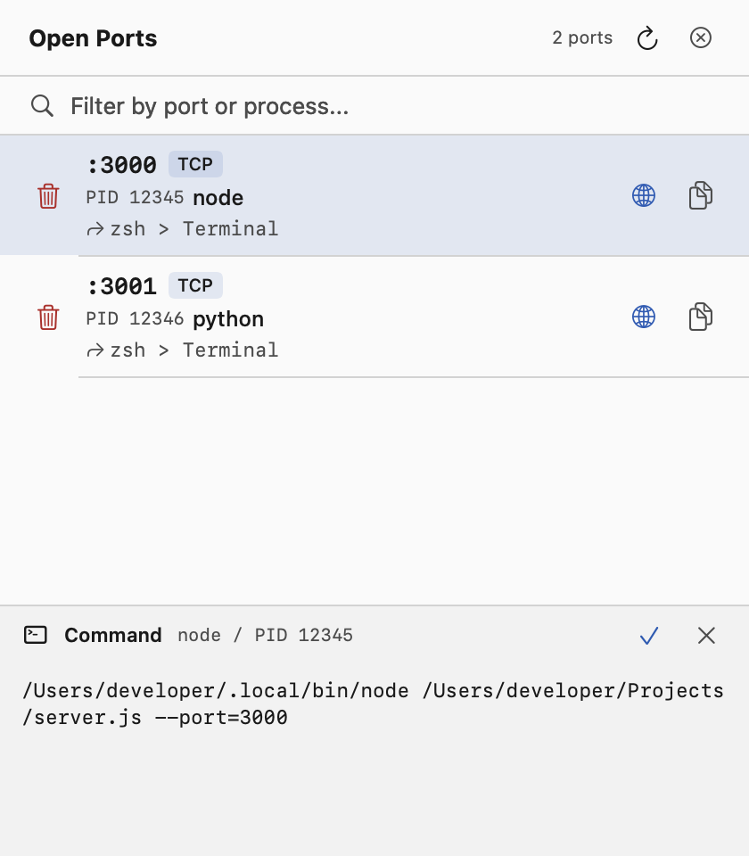

# PortsApp

A lightweight macOS menu bar app that shows all open (listening) ports on your machine. Click the icon, see what's running, and kill anything you don't need.

Forked from [KevLehman/MacPorts](https://github.com/KevLehman/MacPorts).




## Features

- **Menu bar icon** with live port count badge
- **Lists all listening TCP/UDP ports** with process name, PID, and local address
- **Kill processes** directly from the UI with a confirmation dialog
- **Kill filtered processes** with a confirmed snapshot of the search results, one kill per PID, command-line revalidation, and failure reporting
- **Docker integration** — resolves `com.docker` processes to their container name and image
- **Process tree** — shows parent process chain (e.g., `node > zsh > Terminal`)
- **Full command inspector** - hover for a compact preview, then click a row to pin the complete command with wrapping, vertical scrolling, selection, and one-click copy
- **Copy to clipboard** — copy `localhost:<port>` with one click
- **Open in browser** — quick-launch HTTP-likely ports (3000, 8080, etc.)
- **Search/filter** — filter by port number, process name, or Docker container
- **Color-coded rows** — system ports (orange), Docker ports (blue), app ports (default)
- **Readable light and dark themes** with opaque surfaces and higher-contrast text
- **Auto-refresh** — updates every 5s while open, every 30s in background
- **Launch at login** — registers itself via macOS `SMAppService`

## Requirements

- macOS 13.0 (Ventura) or later
- Swift 5.9+ (included with Xcode Command Line Tools)

## Build & Install

```bash
# Clone the repo
git clone https://github.com/DartedMonki/MacPorts.git
cd MacPorts

# Build and create the .app bundle
./build.sh

# Run it
open PortsApp.app

# (Optional) Install to Applications for launch at login
cp -r PortsApp.app /Applications/
```

## Usage

1. After launching, a **network icon** with a port count appears in your menu bar
2. **Click** the icon to open the port list
3. **Hover** over a row to preview its command without changing the list height
4. **Click a row** or the preview's expand icon to pin its full command. Scroll to read long paths, select text, or use the inspector's copy icon to copy the original command. Close it with **X**
5. **Click the trash icon** to kill a process (with confirmation)
6. **Click the globe icon** to open an HTTP port in your browser
7. **Click a row's copy icon** to copy `localhost:<port>` to your clipboard
8. Use the **search bar** to filter by port number, process name, or Docker container. **Kill All** only targets the processes in those results, after confirmation

Killing uses `SIGKILL`: unsaved work may be lost. A process can own multiple ports, and killing a shared Docker host process can affect other containers. Check the confirmation before proceeding.

## Development

```bash
swift test
swift build -c release
```

The test suite covers filtering, unique-PID bulk actions, changed-command rejection, long command lines, light/dark rendering, inspector scrolling and selection, and independent port/command copy actions. Kill tests only terminate disposable child processes created by the tests, and copy tests use a separate pasteboard.

GitHub Actions runs the tests and release build on macOS for pull requests and pushes to `main`.

## License

MIT

